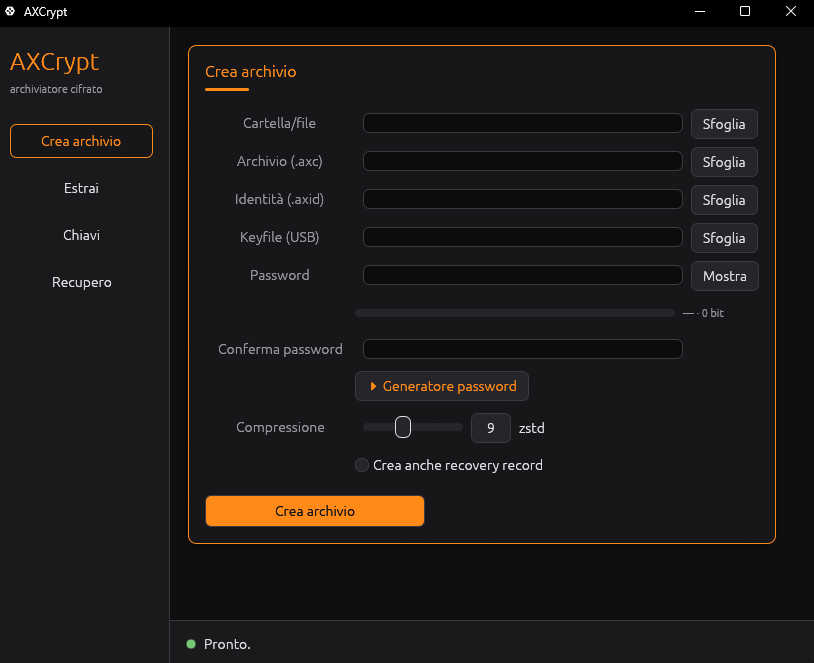

# AXCrypt — archiviatore compresso e cifrato

[](https://github.com/TexAlphaWolf/AXCrypt/actions/workflows/ci.yml)
[](https://github.com/TexAlphaWolf/AXCrypt/releases)


Archiviatore personale con **compressione** (deduplicazione a blocchi + zstd) e
**cifratura autenticata** a due fattori (**password + keyfile**), con **firma**
Ed25519 degli archivi. Formato proprietario `.axc`, aperto e documentato
(`docs/FORMAT_SPEC.md`).

> **Importante, senza giri di parole.** Nessun algoritmo lossless comprime 1 TB
> di dati arbitrari in pochi GB: lo vieta l'entropia di Shannon. Rapporti molto
> alti si ottengono **solo** su dati ridondanti (backup con duplicati), grazie
> alla deduplicazione. La cifratura usa primitive standard (XChaCha20-Poly1305,
> Argon2id, Ed25519): la sicurezza sta nella **chiave**, non nella segretezza
> del formato o nell'offuscamento del codice.

## Stato

v0.5 — core + CLI + **GUI** funzionanti. Features: **multithread** (rayon),
**cifratura a busta** (cambio password istantaneo, più chiavi), **streaming**
(pack/unpack a memoria limitata, ~25 MB di picco anche su archivi da 1 GB+),
**recovery record** (parità Reed-Solomon) e interfaccia grafica egui/eframe.

### GUI

```powershell
cargo run --release -p axcrypt-gui
```

Finestra con schede: Crea archivio, Estrai, Chiavi (identità/keyfile/cambio
password/aggiungi/rimuovi chiave), Recupero (crea .rec / ripara). Le operazioni
lunghe girano in background, l'interfaccia resta reattiva.



> L'immagine sopra è un'anteprima del tema (mockup). Per sostituirla con uno
> screenshot reale: lancia la GUI, cattura la finestra (Win+Maiusc+S) e salva in
> `docs/gui-preview.png`, poi committa.

## Requisiti di build (Windows)

Hai già i Build Tools MSVC con il workload C++. Manca **Rust**: installalo con
rustup (una volta sola):

```powershell
winget install Rustlang.Rustup
rustup default stable-x86_64-pc-windows-msvc
```

Poi, dalla cartella del progetto:

```powershell
cargo build --release
```

Il binario esce in `target\release\axcrypt.exe`.

## Uso rapido

```powershell
# 1) genera la tua identità di firma (una volta): crea la coppia di chiavi
axcrypt keygen --out I:\chiavi\identity.axid

# 2) crea un keyfile da 256 bit da tenere sulla USB (una volta)
axcrypt makekeyfile --out E:\usb\keyfile.bin

# 3) comprimi+cifra+firma una cartella
axcrypt pack --identity I:\chiavi\identity.axid --keyfile E:\usb\keyfile.bin `
             --input .\dati --output .\backup.axc

# 4) elenca il contenuto (richiede password + keyfile)
axcrypt list --keyfile E:\usb\keyfile.bin backup.axc

# 5) estrai (verifica firma, poi decifra)
axcrypt unpack --keyfile E:\usb\keyfile.bin `
               --trust I:\chiavi\identity.axid.pub `
               --input .\backup.axc --output .\ripristino
```

La password viene chiesta a video (input nascosto), non passa mai da riga di
comando.

### Gestione delle chiavi (istantanea, senza ricomprimere)

```powershell
# cambia la password di un archivio esistente
axcrypt changepw .\backup.axc --keyfile E:\usb\keyfile.bin

# aggiungi una seconda password/keyfile che apre lo stesso archivio
axcrypt addkey .\backup.axc --keyfile E:\usb\keyfile.bin

# rimuovi una chiave d'accesso (serve una chiave valida che autorizzi)
axcrypt rmkey .\backup.axc --keyfile E:\usb\keyfile.bin
```

Opzioni utili: `--new-keyfile` per ruotare anche il keyfile in `changepw`/
`addkey`; `--target-keyfile` in `rmkey` per indicare la chiave da togliere.
Fino a 8 chiavi d'accesso per archivio; l'ultima non è rimovibile.

### Recovery record (riparare archivi danneggiati)

Crea un file `.rec` con parità Reed-Solomon: se parte dell'archivio si corrompe
(settori danneggiati, errori di copia), lo ricostruisci.

```powershell
# crea il recovery record (ridondanza 10% = tollera ~10% di blocchi danneggiati)
axcrypt protect .\backup.axc --redundancy 10

# ripara un archivio danneggiato (scrive backup.axc.repaired)
axcrypt repair .\backup.axc
```

Il `.rec` è un file separato: tienilo accanto all'archivio (o su un altro
supporto). L'archivio resta intatto e la firma valida. Più alta la ridondanza,
più danni tollera, più grande il `.rec`.

## Sicurezza — cosa garantisce e cosa no

- **Riservatezza + integrità** di dati e metadati (nomi file inclusi): AEAD.
- **Due fattori**: senza *sia* password *sia* keyfile, l'archivio non si apre.
- **Autenticità**: `--trust` fa accettare solo archivi firmati dalla tua chiave.
- Non protegge da: password debole (usa password lunga + keyfile), furto
  simultaneo di password e USB, malware sul sistema mentre lavori in chiaro.

## Sviluppo

Prima di committare, formatta e controlla il codice (gli stessi controlli della CI):

```powershell
cargo fmt --all
cargo clippy -p axcrypt-core --release -- -D warnings
cargo test -p axcrypt-core
```

Per automatizzarli, attiva l'hook pre-commit incluso (una volta sola):

```powershell
git config core.hooksPath .githooks
```

Da lì ogni `git commit` esegue `cargo fmt --check` e `cargo clippy` e si blocca
se qualcosa non è a posto, così la CI non ti sorprende.

## Pubblicazione e release

Integrazione continua con GitHub Actions (vedi `.github/workflows/`):

- **CI** (`ci.yml`): a ogni push/PR compila e testa il core su Linux, l'intero
  workspace su Windows, e controlla formattazione e lint.
- **Release** (`release.yml`): spingendo un tag `vX.Y.Z` compila i binari,
  genera l'installer con Inno Setup e pubblica una Release con allegati
  `AXCrypt-Setup.exe`, `axcrypt.exe`, `axcrypt-gui.exe`.

Per pubblicare il progetto su GitHub:

```powershell
cd I:\Archiviatore-cifrato
git init
git add .
git commit -m "AXCrypt v0.5"
git branch -M main
git remote add origin https://github.com/TexAlphaWolf/AXCrypt.git
git push -u origin main
# per creare una release con installer:
git tag v0.5.0
git push --tags
```

(Il `.gitignore` esclude già `target/`, le chiavi `*.axid`/`*.key`, i keyfile e
gli archivi `*.axc`, così non finiscono per errore nel repository.)

## Licenza

**Software proprietario. Copyright (c) 2026 Tessitore Luca ("TexAlphaWolf").
Tutti i diritti riservati.** Vedi il file [`LICENSE`](LICENSE). Il codice è
pubblicato a solo scopo di consultazione e valutazione: nessun diritto di uso,
copia, modifica o distribuzione è concesso senza consenso scritto del titolare.
